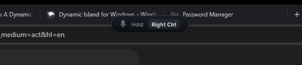
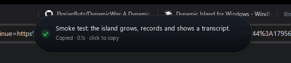
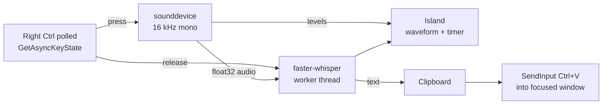

# STT Island

A Dynamic-Island-style pill at the top of the screen that turns your voice into text in any Windows app.
**Hold a key, speak, release** — the transcript is pasted where your cursor was. Local Whisper, no cloud, no account.

| Idle | Listening | Result |
|---|---|---|
|  |  |  |

## Why

There are a dozen Dynamic Island clones for Windows (see [Similar projects](#similar-projects)), but they are
notification widgets: music, timers, clipboard, AI chat. None of them is built around **push-to-talk dictation**,
which is the one thing this repo does. The island is the feedback surface — it tells you the mic is live, shows
the level, then shows what it heard — and the actual job is getting clean text into the field you were typing in.

## Features

- **Hold to talk, anywhere.** Default key `Right Ctrl`, configurable to any single key (Caps Lock, F8, backtick…).
  Read with `GetAsyncKeyState`, so there is no keyboard hook, no admin prompt, and no swallowed keystrokes.
- **Live island.** Pill expands into a recorder with a red pulse, a scrolling waveform and a timer, then a
  "Transcribing…" state, then the transcript. It never takes focus, so the caret stays where it was.
- **Local Whisper.** [faster-whisper](https://github.com/SYSTRAN/faster-whisper) on the CPU (int8). Models from
  `tiny` to `large-v3`, downloaded once into `models/` and reused offline.
- **Paste into the focused app** with clipboard + `SendInput` Ctrl+V. The transcript is always left on the
  clipboard too; click the result pill to copy it again.
- **99 languages.** Auto-detect by default, or pin one in settings.
- **Tray app.** Settings dialog, "copy last", "start with Windows", quit. No console window with the `.vbs` launcher.
- **Fully offline** after the first model download. Nothing is sent anywhere.
- **`--preview`** cycles the island states for screenshots or a quick look without a microphone.

## Install

Windows 10/11, Python 3.10+ (tested on 3.12).

```
git clone https://github.com/yassine808/stt-island.git
cd stt-island
pip install -r requirements.txt
```

Run it:

```
python main.py
```

or double-click **`Start STT Island.vbs`** to start it without a console window.

The first start downloads the Whisper model (about 480 MB for `small`) into `models/`. The island shows
"Loading small model…" until it is ready; after that it is instant.

## Use

1. Put the cursor where you want the text.
2. Hold **Right Ctrl**, speak, release.
3. The text is pasted into the app you were in.

| Action | What it does |
|---|---|
| Hold the key | Record |
| Release | Transcribe and paste |
| Click the result pill | Copy the transcript again |
| Right-click the pill / tray icon | Menu: settings, copy last, start with Windows, quit |
| Drag the pill | Move it along the top of the screen |

If a recording is shorter than 0.35 s it is thrown away. Recordings stop by themselves at 180 s.

## Models

| Model | Disk | Speed (CPU, int8) | Notes |
|---|---|---|---|
| `tiny` | ~75 MB | fastest | rough, good for commands |
| `base` | ~145 MB | fast | usable |
| `small` | ~480 MB | ~0.5× realtime | **default**, good dictation |
| `medium` | ~1.5 GB | ~1.5× realtime | better, slower |
| `large-v3` | ~3 GB | ~3× realtime | best, much slower |
| `distil-small.en` / `distil-medium.en` | ~150 MB / ~800 MB | fast | English only |

Switch in Settings. A new model loads in the background; the island shows progress.

## Settings

`config/config.json` is created on first run:

| Key | Default | Meaning |
|---|---|---|
| `hotkey` | `"right ctrl"` | Any single key: `left ctrl`, `caps lock`, `f8`, `backtick`, `scroll lock`, `pause`… |
| `model` | `"small"` | Whisper model name |
| `language` | `""` | `""` = auto detect, or `en`, `fr`, `ar`, `es`… |
| `beam_size` | `1` | 1 = greedy (fastest); 5 = a bit more accurate |
| `paste_into_app` | `true` | Paste on release; when off, only the clipboard is filled |
| `play_sounds` | `true` | Short cues on press / release / done |
| `accent` | `"#5AC8FA"` | Waveform and border colour |
| `min_seconds` | `0.35` | Ignore accidental taps |
| `max_seconds` | `180` | Hard stop |
| `show_hint` | `true` | Reserved |

Logs go to `config/stt-island.log`.

## How it works



The UI thread never blocks: the model loads and every transcription runs on its own daemon thread and reports
back through Qt signals.

## Verified

```
python tools/selftest.py --model small
[1/3] synthesising speech with Windows TTS -> speech.wav
[2/3] audio 8.39s at 16 kHz, loading 'small'
[3/3] model 55.3s, transcription 4.4s
expected: This is a test of the speech to text island. Hold the key, speak clearly, and the words appear where the cursor is.
got     : This is a test of the speech to text island. Hold the key, speak clearly, and the words appear where the cursor is.
word match: 23/23 = 100%
PASS
```

`python main.py --smoke` drives the island through idle → listening → thinking → result and exits.

## Notes and limits

- The mic opens on press, which costs ~100 ms. Speak after the pill expands; the first syllable is not clipped
  in practice, but very fast talkers should wait for the red dot.
- A target app running **as administrator** ignores simulated keystrokes from a non-elevated process. Run the
  island elevated too if you dictate into an elevated terminal.
- Windows only: `GetAsyncKeyState` and `SendInput` are Win32 calls.
- Model accuracy depends on the mic and the model. `small` handles English, French and Arabic well; use
  `medium`/`large-v3` for heavy accents or noisy rooms.

## Similar projects

Windows Dynamic Island clones found while building this. All are notification/widget islands; none does
hold-to-talk dictation.

| Project | Stack | Focus |
|---|---|---|
| [Atoll](https://github.com/Fuwni/dynamic-island-windows) | — | music + lyrics, live activities, screenshots/OCR, weather, AI chat |
| [ReUI](https://github.com/ocopus-labs/ReUI) | Rust | music, clipboard history, timers, devices, coding agents |
| [Lumen](https://github.com/Risuleia/Lumen) | Rust + Slint | Dynamic Island for Windows 10+ |
| [Crest](https://github.com/andrealo20/crest) | Tauri + React + Rust | music/lyrics, notices, timers, screenshots, terminal, launcher |
| [Pillar](https://github.com/warpirate/pillar-dynamic-island-for-windows) | — | free Dynamic Island for Windows 10/11 |
| [dynamic-island-for-windows](https://github.com/rajsriv/dynamic-island-for-windows) | Python + PyQt6 | fluid, customisable island |
| [Island](https://github.com/exuupery/island) | — | music, clipboard, screenshots, command bar |
| [windows-dynamic-island](https://github.com/HeyyCzer/windows-dynamic-island) | — | music controls, AI agent activity |

## License

MIT — see [LICENSE](LICENSE).
