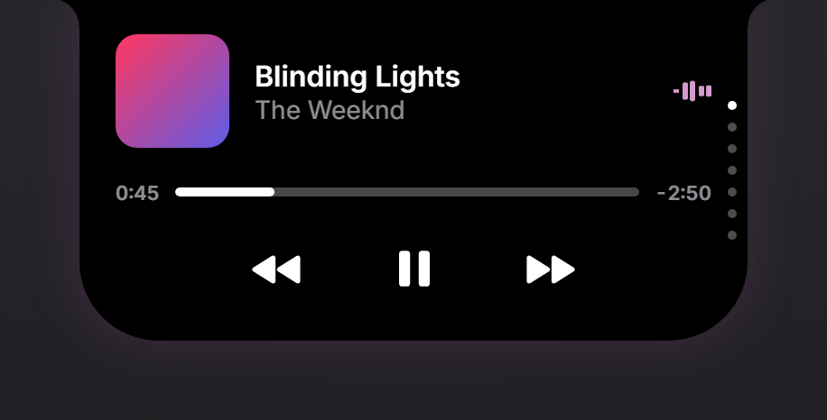
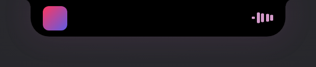

# IslandWin

Dynamic Island for Windows: media controls, dictation, timers and system stats in one pill that
lives on the screen edge.

| Media controls | Dictation |
| --- | --- |
|  |  |

| Collapsed | Settings |
| --- | --- |
|  |  |

## Install

Download `IslandWin_0.1.0_x64-setup.exe` from the
[releases page](https://github.com/yassine808/windows-dynamic-island/releases) and run it. It needs
no administrator rights: the app goes to `%LOCALAPPDATA%\IslandWin`, and WebView2 is already on
Windows 11 (the setup downloads it on Windows 10 if it is missing).

The setup turns on **Start with Windows** for you (it is the default answer to its one question),
and the same switch is on the island's **Settings** page, so it can be turned off at any time.

Upgrading or uninstalling never touches your data:

| What | Where |
| --- | --- |
| Settings (shortcut, hold/toggle) | `%APPDATA%\dev.yassine808.islandwin\settings.json` |
| Log (app + dictation timings) | `%APPDATA%\dev.yassine808.islandwin\logs\islandwin.log` |
| UI preferences (edge, auto-hide) | the webview's local storage for the app |
| Autostart | `HKCU\Software\Microsoft\Windows\CurrentVersion\Run\IslandWin` |

## Use

- Play music in Spotify or a browser: the island shows it. Hover to expand, use prev / play / next.
- Drag the island: it flicks and snaps to the nearest screen edge. Near the middle of the screen it
  sticks to the center (like Word's guides) until you pull away. On left/right/bottom it turns
  vertical and tucks away when idle.
- Scroll the mouse wheel over the island to switch pages; a long scroll keeps going to the last page.
- Dictation shortcut defaults to `Ctrl+Alt+Space`. On the Dictation page, click the shortcut chip and
  press the combo you want. The island takes the keyboard for a moment so the capture also works over
  a fullscreen game or an elevated window, and Escape cancels. The chip stays armed if a combo is
  taken and asks for another one. Hold / Toggle picks push-to-talk or press-to-start/stop.
- Finished phrases are typed into whatever text field has focus. Needs
  Settings > Privacy > Speech > Online speech recognition.
- Timer: pick 5, 15 or 25 minutes (starts right away) or set any time on the wheels; pause with the
  button. It keeps running in the collapsed island and beeps when done.
- Cursor stays the normal arrow while hovering; it only becomes a grabbing hand during an actual drag.
- Set `SCRUBBER = false` in `src/App.tsx` to hide the elapsed/remaining bar.

## Pages

Media, Dictation, Timer, Mixer, Stats, Tools, Settings.

- **Settings**: auto-hide per axis (up/down, left/right), hide while a windowed fullscreen app is in
  front, and Start with Windows.
- **Mixer**: speaker and mic volume sliders with mute buttons (default devices).
- **Stats**: CPU, RAM, network, and GPU (NVIDIA only, needs `nvidia-smi`; shows n/a otherwise).
- **Tools**: Screenshot saves all monitors to Pictures/IslandWin (the island is left out). Pick color:
  move over any pixel, click to copy its hex; that click also reaches the app underneath. Clipboard
  keeps your last copied text (password-manager copies are skipped), click an entry to copy it again.
  History is in memory only.
- Fullscreen games: DirectX/exclusive fullscreen can make screenshots black.

## Build from source

1. Install Node 20+, Rust (stable MSVC) and WebView2 (preinstalled on Windows 11).
2. `npm install`
3. `npm run tauri dev` for the live app, `npm run tauri build` for
   `src-tauri/target/release/bundle/nsis/IslandWin_0.1.0_x64-setup.exe`.

The installer hook (`src-tauri/windows/installer.nsh`) adds the Run entry, and the app keeps it
pointing at the executable it is actually running from, so moving the app does not break autostart.

## Checks

CI runs on every push and pull request:

- `npm run typecheck`, `npm run build` — TypeScript and the production bundle.
- `node scripts/design-check.mjs` — the Apple-style guardrails: one color palette, one type scale,
  the two house easing curves, reduced-motion support, no emoji, WCAG AA contrast for the text.
- `cargo check --all-targets`, `cargo test` — the Rust side, including the shortcut recorder's key
  names and combo rules. The synthetic-key end-to-end test is opt-in locally with
  `ISLANDWIN_E2E=1 cargo test`.
- `node scripts/secret-scan.mjs` — no tokens, private keys or secret files in tracked files.

Dictation latency and CPU/RAM measurements, and how to reproduce them, are in
[`benchmarks/`](benchmarks/README.md).

## Privacy

Dictation audio goes to the speech recognition service that Windows and WebView2 use (Microsoft);
nothing else leaves the machine. Media, volume and stats are read locally, and the screenshot tool
saves only to your Pictures folder.
