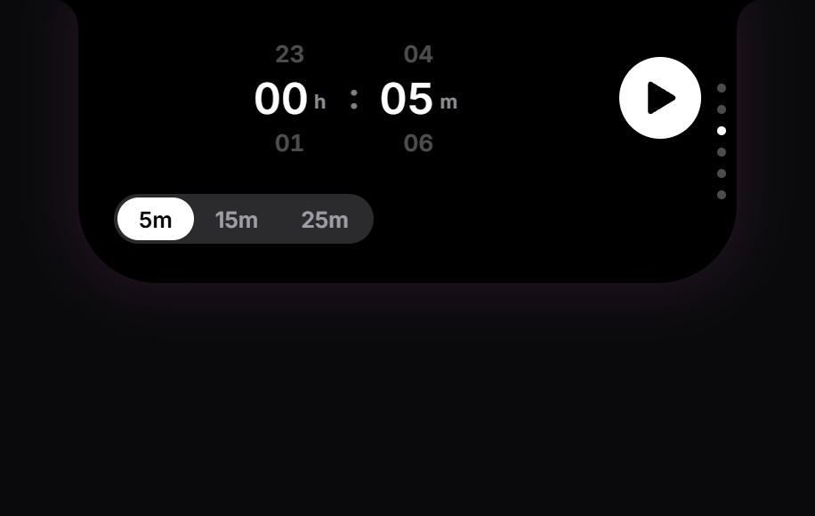
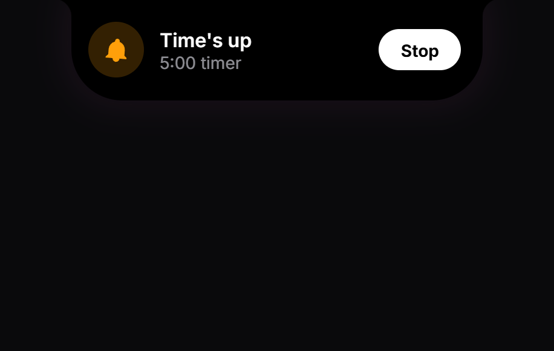

# IslandWin

Dynamic Island for Windows: media controls, dictation, timers and system stats in one pill that
lives on the screen edge.

| Media controls | Dictation |
| --- | --- |
|  |  |

| Timer | Alarm |
| --- | --- |
|  |  |

| Collapsed | Settings |
| --- | --- |
|  |  |

## Install

Download `IslandWin_0.1.0_x64-setup.exe` from the
[releases page](https://github.com/yassine808/windows-dynamic-island/releases) and run it. It needs
no administrator rights: the app goes to `%LOCALAPPDATA%\IslandWin`, and WebView2 is already on
Windows 11 (the setup downloads it on Windows 10 if it is missing).

The setup turns on **Start with Windows** for you (it is the default answer to its one question),
and the same switch is on the island's **Settings** page, so it can be turned off at any time.

Upgrading or uninstalling never touches your data:

| What | Where |
| --- | --- |
| Settings (shortcut, hold/toggle) | `%APPDATA%\Windows Dynamic Island\settings.json` |
| Log (app + dictation timings; rotates at 2 MB) | `%APPDATA%\Windows Dynamic Island\logs\islandwin.log` |
| UI preferences (edge, auto-hide) | the webview's local storage for the app |
| Autostart | `HKCU\Software\Microsoft\Windows\CurrentVersion\Run\IslandWin` |

The first launch of this version copies the old `%APPDATA%\dev.yassine808.islandwin` settings and log
into the new folder; the old folder is left in place.

The log never grows past ~2 MB: when full it rotates to `logs\islandwin.old.log` (one previous file),
so both files stay small and the app keeps logging.

## Use

- Play music in Spotify or a browser: the island shows it. Hover to expand, use prev / play / next.
- Drag the island: it flicks and snaps to the nearest screen edge. Near the middle of the screen it
  sticks to the center (like Word's guides) until you pull away. On left/right/bottom it turns
  vertical and tucks away when idle.
- Changing the resolution or connecting a Parsec / remote display moves the overlay with the desktop,
  so the island stays on its edge instead of staying at the old screen's coordinates.
- Scroll the mouse wheel over the island to switch pages; a long scroll keeps going to the last page.
- Dictation shortcut defaults to `Ctrl+Alt+Space`. On the Dictation page, click the shortcut chip and
  press any key or any mouse button (bare keys work; left click is never recorded). The island takes
  the keyboard for a moment so the capture also works over a fullscreen game or an elevated window.
  Click the chip again to cancel. The red reset button puts `Ctrl+Alt+Space` back. Hold / Toggle picks
  push-to-talk or press-to-start/stop.
- Finished phrases are typed into whatever text field has focus. Needs
  Settings > Privacy > Speech > Online speech recognition.
- The Windows recognizer is built once at launch on a background thread, so a press starts listening
  instead of compiling the dictation grammar again, and start/stop reach the island immediately.
- Timer: pick 5, 15 or 25 minutes to fill the hours / minutes wheels, or turn the wheels yourself,
  then press play. Pause and resume with the same button. When it reaches zero the island grows into
  an alarm pill with a looping chime and stays there, ringing, until you press **Stop**.
- The collapsed pill shows the track's elapsed time while media plays; with nothing playing it shows
  the normal 12-hour clock.
- Cursor stays the normal arrow over the island. The hand appears only on things you can click:
  buttons and sliders. During a real drag it becomes a grabbing hand.
- Settings has a **Lock position** switch: the island stays where it is until you unlock it, while
  its buttons, wheels and sliders keep working.
- Set `SCRUBBER = false` in `src/App.tsx` to hide the elapsed/total bar.
- The notification-area icon opens Settings on left click. Right click shows Settings, Start with
  Windows (the same switch as the Settings page) and Quit. Windows hides new tray icons behind the
  `^` overflow until you pin them to the taskbar.

## Pages

Media, Dictation, Timer, Mixer, Stats, Settings.

- **Settings**: auto-hide per axis (up/down, left/right), hide while a **fullscreen window / app** is
  in front (a normal maximized window does not count), lock position, and Start with Windows.
- **Mixer**: speaker and mic volume sliders with mute buttons (default devices).
- **Stats**: CPU, RAM, network, and GPU (NVIDIA only, needs `nvidia-smi`; shows n/a otherwise).

## Build from source

1. Install Node 20+, Rust (stable MSVC) and WebView2 (preinstalled on Windows 11).
2. `npm install`
3. `npm run tauri dev` for the live app, `npm run tauri build` for
   `src-tauri/target/release/bundle/nsis/IslandWin_0.1.0_x64-setup.exe`.

The installer hook (`src-tauri/windows/installer.nsh`) adds the Run entry, and the app keeps it
pointing at the executable it is actually running from, so moving the app does not break autostart.

## Checks

CI runs on every push and pull request:

- `npm run typecheck`, `npm run build` — TypeScript and the production bundle.
- `node scripts/design-check.mjs` — the Apple-style guardrails: one color palette, one type scale,
  the two house easing curves, reduced-motion support, no emoji, WCAG AA contrast for the text.
- `cargo check --all-targets`, `cargo test` — the Rust side, including the shortcut recorder's key
  names and combo rules, the autostart round trip, the fullscreen-window rules, and the 2 MB log cap.
  Two end-to-end tests touch the real desktop and the real Run key, so they are opt-in locally with
  `ISLANDWIN_E2E=1 cargo test`.
- `node scripts/secret-scan.mjs` — no tokens, private keys or secret files in tracked files.

Dictation latency and CPU/RAM measurements, and how to reproduce them, are in
[`benchmarks/`](benchmarks/README.md).

## Privacy

Dictation audio goes to the speech recognition service that Windows and WebView2 use (Microsoft);
nothing else leaves the machine. Media, volume and stats are read locally.
