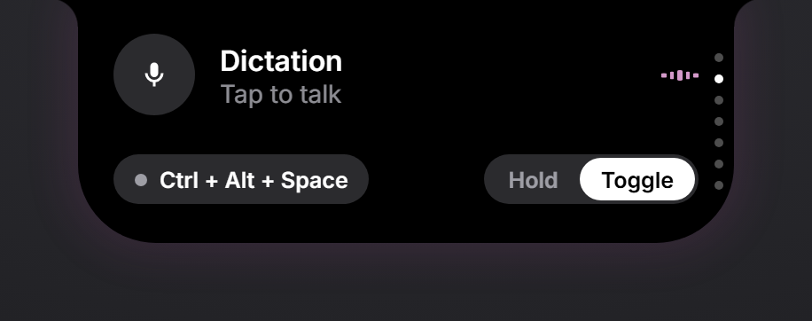
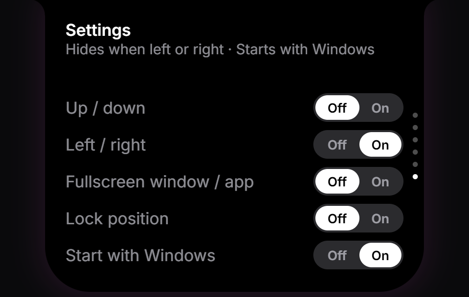

# IslandWin

A Dynamic Island for Windows: media controls, dictation, timers, volume and system stats in one
small pill on the edge of your screen.


## Download

**[Download the latest version](https://github.com/yassine808/windows-dynamic-island/releases/latest)**

Windows 10/11 · no administrator rights · 2.4 MB

## Install

1. Download `IslandWin_0.1.4_x64-setup.exe`.
2. Run it. No administrator rights are needed.
3. IslandWin starts with Windows by default. You can turn that off in its Settings.

## What it does

- **Media** — shows the song and cover from Spotify or a browser. Hover for prev / play / next and seek.
- **Dictation** — hold the shortcut and speak; the words are typed into the field you are in.
- **Timer** — 5, 15 or 25 minutes, or set your own. The island rings when time is up.
- **Mixer** — speaker and microphone volume, with mute.
- **Stats** — CPU, RAM, network and NVIDIA GPU.

| Media | Dictation |
| --- | --- |
|  |  |

| Timer | Settings |
| --- | --- |
|  |  |

## How to use

- Hover over the pill to expand it; move away to collapse.
- Drag it to a screen edge. It snaps there and tucks away when idle.
- Scroll the mouse wheel over it to switch pages.
- Dictation shortcut is `Ctrl+Alt+Space` by default; change it on the Dictation page.
- In windowed or borderless fullscreen games the island tucks into the edge; in exclusive fullscreen
  it hides. You can change this in Settings.
- The tray icon opens Settings. Right-click it to quit.

## Requirements

Windows 10 or 11. WebView2 comes with Windows 11; the installer adds it on Windows 10 if needed.

Dictation uses Windows speech recognition, so turn on **Settings > Privacy > Speech > Online speech
recognition**.

## Your data

Settings and logs are kept in `%APPDATA%\Windows Dynamic Island`. Upgrading or uninstalling does not
delete them. Uninstall from Windows Settings > Apps.

Media, volume and stats are read locally. Dictation audio goes to Microsoft's speech service.

## Build from source


Needs Node 20+, Rust (stable MSVC) and WebView2.

```sh
npm install
npm run tauri dev    # live app
npm run tauri build  # installer
```

CI runs typecheck, the production build, the design checks, `cargo check`, `cargo test` and a secret
scan on every push. See [`.github/workflows/ci.yml`](.github/workflows/ci.yml).
